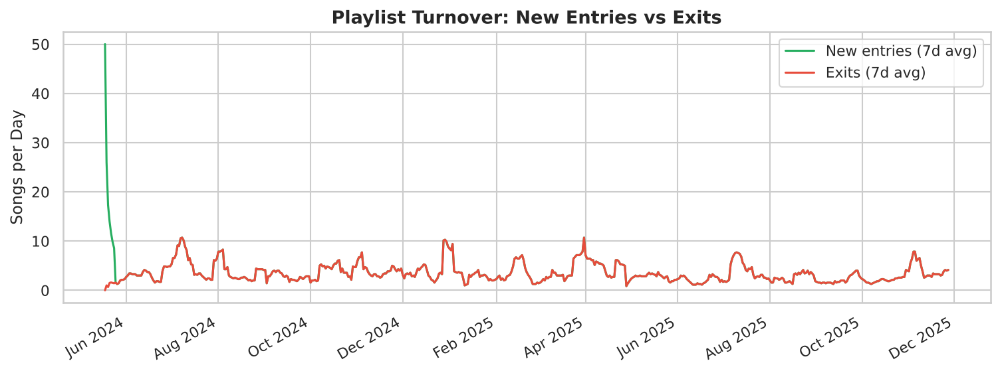
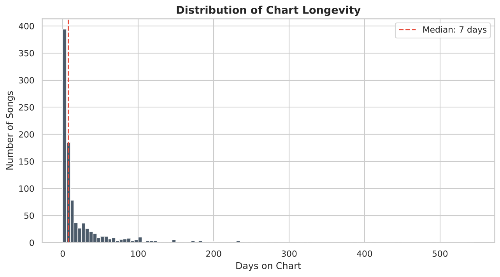
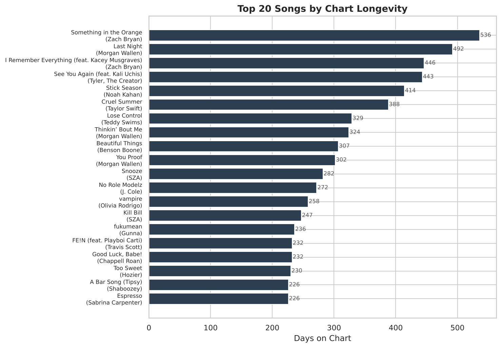
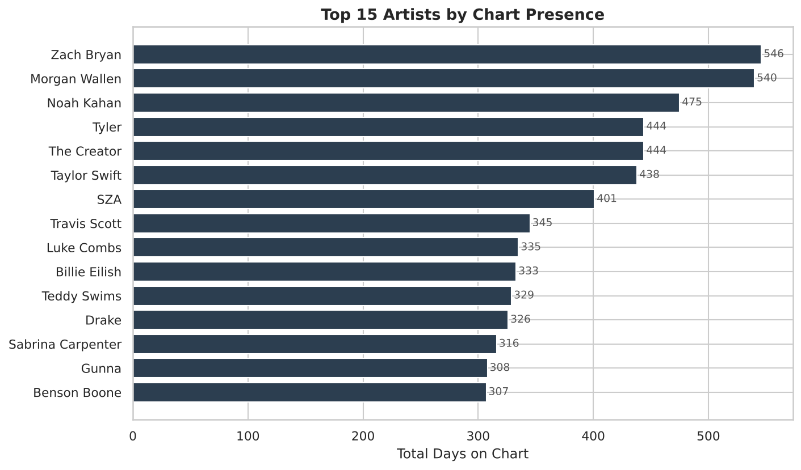
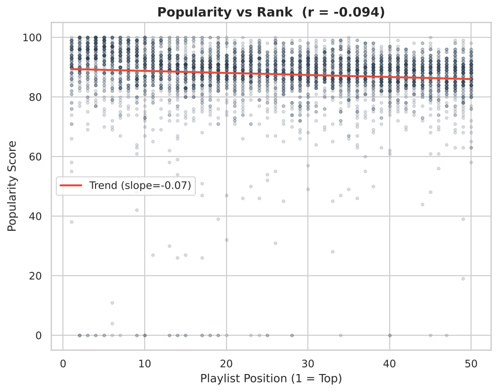
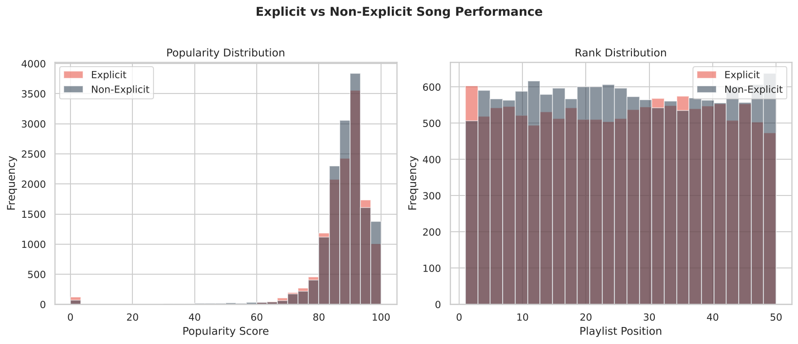
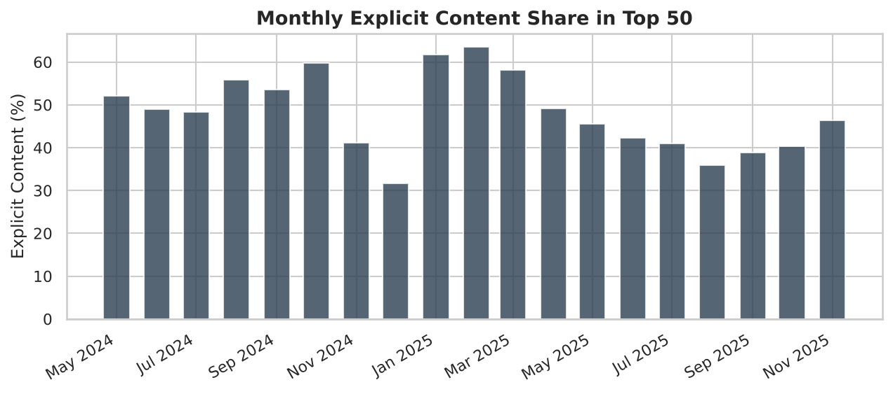
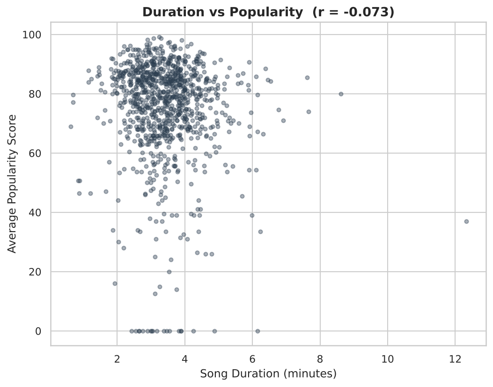
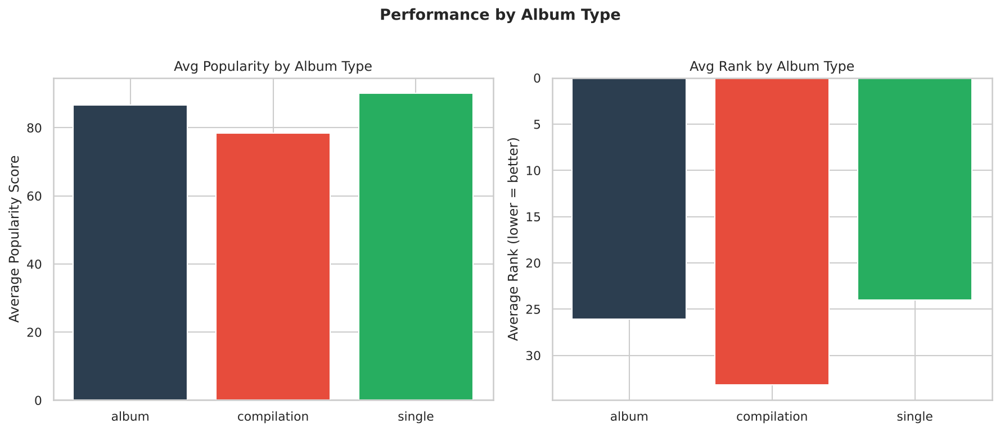

**Research Paper**

**Author:** Gauri Shinde, Second-year Computer Science student, University of Greenwich

Generated 2026-10-24 | pipeline runtime 5.4s

## Abstract

This paper presents an exploratory data analysis of 555 daily snapshots of the United States Top 50 streaming playlist, spanning 2024-05-18 to 2025-11-27. The dataset contains 27,750 entries covering 943 unique songs by 297 artists. We analyse playlist ranking patterns, song longevity, artist dominance, popularity-rank relationships, and the influence of content attributes (explicit flag, album type, song duration) on chart performance. Key findings include a weak negative correlation between playlist rank and popularity score (r = -0.094), a median chart stay of 7 days, and minimal performance differences between explicit and non-explicit content. Recommendations for release timing, catalogue strategy, and promotion are provided.

## 1. Introduction

Streaming playlists have become the primary discovery channel for recorded music. A song's position on a major national playlist directly affects its stream count, revenue, and the artist's visibility. For record labels, understanding what drives chart persistence, how quickly songs rise or fall, and whether content attributes like explicit labelling or album type affect performance is essential for promotion and release strategy.

This project analyses the United States Top 50 playlist from Atlantic Recording Corporation's perspective. The work is purely descriptive and historical: the aim is to surface patterns in past playlist behaviour, not to build a predictive or recommendation model. Each section answers a concrete question about playlist dynamics, backed by summary statistics and visualisation.

## 2. Data Description

The dataset comprises **27,750 daily playlist entries** across **555 snapshot dates** from 2024-05-18 to 2025-11-27. Each row records one song's position (rank 1-50), its popularity score, duration, album type, explicit flag, and album metadata.

### 2.1 Data quality

- **Zero null values** across all 10 columns.
- One duplicate snapshot on 2025-03-01 (100 rows instead of 50) was deduplicated, keeping the first occurrence for each position.
- After cleaning: 27,750 rows, each date having exactly 50 entries.
- Popularity scores range from 0-100.
- Song durations range from 0.62-12.33 minutes.

### 2.2 Album types

- **Album**: 745 unique songs, avg popularity 86.7, avg rank 26.1
- **Compilation**: 8 unique songs, avg popularity 78.4, avg rank 33.2
- **Single**: 239 unique songs, avg popularity 90.1, avg rank 24.0

## 3. Methodology

The analysis follows the brief's six-step methodology:

1. **Data ingestion and validation**: dates parsed from DD-MM-YYYY format, rank range confirmed as 1-50, artist names standardised, duplicates removed.
2. **Feature engineering**: derived metrics include Days on Chart, Average Rank, Best Rank Achieved, Rank Volatility Index (standard deviation of daily ranks), Popularity Trend Score (last-week vs first-week average popularity), and Duration in minutes.
3. **Playlist ranking analysis**: daily rank distributions, entry/exit rates, fast risers and slow decliners.
4. **Song-level performance analysis**: longevity, peak rank, popularity stability.
5. **Artist performance analysis**: chart presence, song count, dominance index (share of all available chart slots), collaborative vs solo performance.
6. **Content attribute analysis**: explicit vs non-explicit, single vs album, duration correlations, rank-tier breakdowns.

All computations run in Python (pandas, numpy, scipy) with the pipeline orchestrated by `train.py`. The Streamlit dashboard reads the same artefacts the report does, so the two are always consistent.

## 4. Playlist Ranking Analysis

### 4.1 Turnover

The playlist is not static. On an average day, new songs enter and others exit. The entry/exit timeline (Figure 1) shows periods of high churn interspersed with stable stretches where the same songs hold their positions for days or weeks.

*Figure 1: Daily new entries and exits (7-day rolling average).*

### 4.2 Fast risers

**15 songs** reached the top 5 within their first 14 days on the chart. Examples:

| Song | Artist | Days to Peak | Best Rank | Total Days |
| --- | --- | --- | --- | --- |
| I Remember Everything (feat. Kacey Musgraves) | Zach Bryan | 0 | 1 | 446 |
| vampire | Olivia Rodrigo | 0 | 1 | 258 |
| FE!N (feat. Playboi Carti) | Travis Scott | 0 | 2 | 232 |
| Not Like Us | Kendrick Lamar | 0 | 1 | 201 |
| Ella Baila Sola | Eslabon Armado | 0 | 1 | 170 |
| Like That | Future & Metro Boomin | 0 | 1 | 169 |
| First Person Shooter (feat. J. Cole) | Drake | 0 | 1 | 138 |
| Saturn | SZA | 0 | 3 | 119 |
| CARNIVAL | ¥$ & Kanye West & Ty Dolla $ign | 0 | 1 | 103 |
| Fortnight (feat. Post Malone) | Taylor Swift | 0 | 1 | 103 |

### 4.3 Slow decliners

These songs stayed on the chart for over 100 days and reached the top 20 at least once:

| Song | Artist | Days | Best Rank | Avg Rank |
| --- | --- | --- | --- | --- |
| Something in the Orange | Zach Bryan | 536 | 9 | 26.29 |
| Last Night | Morgan Wallen | 492 | 1 | 22.61 |
| I Remember Everything (feat. Kacey Musgraves) | Zach Bryan | 446 | 1 | 13.90 |
| See You Again (feat. Kali Uchis) | Tyler, The Creator | 443 | 4 | 29.34 |
| Stick Season | Noah Kahan | 414 | 1 | 18.29 |
| Cruel Summer | Taylor Swift | 388 | 1 | 16.92 |
| Lose Control | Teddy Swims | 329 | 5 | 23.50 |
| Beautiful Things | Benson Boone | 307 | 1 | 14.70 |
| You Proof | Morgan Wallen | 302 | 9 | 32.60 |
| Snooze | SZA | 282 | 9 | 30.45 |

## 5. Song-Level Performance Analysis

Across 943 unique songs, the median chart stay is **7 days** and the longest is **536 days**.

*Figure 2: Distribution of chart longevity across all songs.*

### Top 10 songs by longevity

| Song | Artist | Days | Avg Rank | Best | Volatility | Avg Pop | Trend |
| --- | --- | --- | --- | --- | --- | --- | --- |
| Something in the Orange | Zach Bryan | 536 | 26.29 | 9 | 9.35 | 88.40 | -3.00 |
| Last Night | Morgan Wallen | 492 | 22.61 | 1 | 14.55 | 85.70 | -8.00 |
| I Remember Everything (feat. Kacey Musgraves) | Zach Bryan | 446 | 13.90 | 1 | 9.89 | 90.10 | 10.60 |
| See You Again (feat. Kali Uchis) | Tyler, The Creator | 443 | 29.34 | 4 | 11.79 | 91.10 | -4.00 |
| Stick Season | Noah Kahan | 414 | 18.29 | 1 | 11.36 | 91.10 | 4.90 |
| Cruel Summer | Taylor Swift | 388 | 16.92 | 1 | 13.63 | 97.00 | 0.70 |
| Lose Control | Teddy Swims | 329 | 23.50 | 5 | 8.65 | 90.90 | 5.00 |
| Thinkin’ Bout Me | Morgan Wallen | 324 | 39.02 | 21 | 7.14 | 86.00 | -2.90 |
| Beautiful Things | Benson Boone | 307 | 14.70 | 1 | 8.94 | 90.80 | 6.00 |
| You Proof | Morgan Wallen | 302 | 32.60 | 9 | 12.03 | 84.70 | -3.00 |

*Figure 3: Top 20 songs by days on chart.*

## 6. Artist Performance Analysis

The dataset includes 297 credited artist strings, which expand to 289 individual artists after splitting collaborations.

*Figure 4: Top 15 artists by total days on chart.*

### Top 10 artists by chart presence

| Artist | Songs | Chart Days | Avg Rank | Avg Pop | Dominance % |
| --- | --- | --- | --- | --- | --- |
| Zach Bryan | 38 | 546 | 25.66 | 85.80 | 6.78 |
| Morgan Wallen | 11 | 540 | 29.17 | 85.90 | 6.36 |
| Noah Kahan | 12 | 475 | 20.02 | 88.80 | 1.83 |
| Tyler | 16 | 444 | 25.26 | 88.40 | 2.54 |
| The Creator | 16 | 444 | 25.26 | 88.40 | 2.54 |
| Taylor Swift | 96 | 438 | 24.55 | 87.10 | 7.26 |
| SZA | 6 | 401 | 25.73 | 91.30 | 2.42 |
| Travis Scott | 33 | 345 | 25.58 | 88.40 | 2.89 |
| Luke Combs | 7 | 335 | 27.85 | 86.30 | 1.41 |
| Billie Eilish | 14 | 333 | 20.86 | 92.60 | 2.88 |

## 7. Popularity Score Analytics

The correlation between playlist position and popularity score is **r = -0.094** — a weak negative relationship. Higher-ranked songs tend to be slightly more popular, but the relationship is far from deterministic. Many lower-ranked songs carry popularity scores comparable to top-10 entries.

*Figure 5: Popularity score vs playlist position (sample of 5,000 data points).*

### Popularity by rank tier

| Rank Range | Avg Pop | Median Pop | Std Dev | Explicit % |
| --- | --- | --- | --- | --- |
| 1-10 | 89.60 | 93.00 | 13.50 | 49.20 |
| 11-20 | 87.60 | 89.00 | 11.60 | 46.70 |
| 21-30 | 87.50 | 89.00 | 9.70 | 47.00 |
| 31-40 | 87.10 | 88.00 | 8.30 | 50.10 |
| 41-50 | 86.50 | 88.00 | 8.00 | 46.70 |

Top-10 songs average **89.6** popularity vs **87.2** for positions 11-50 — a modest gap, indicating that playlist position is influenced by factors beyond the popularity metric alone.

## 8. Content Attribute Analysis

### 8.1 Explicit vs non-explicit

Explicit songs make up **47.9%** of all chart entries. Their average popularity (87.3) is nearly identical to non-explicit songs (88.0), and their average rank (25.4) is comparable to non-explicit (25.6). The explicit label appears to have **no meaningful impact** on chart performance in this dataset.

*Figure 6: Popularity and rank distributions by explicit flag.*

*Figure 7: Monthly explicit content share in the Top 50.*

### 8.2 Album type

- **Album** tracks: avg popularity 86.7, avg rank 26.1. 
- **Compilation** tracks: avg popularity 78.4, avg rank 33.2. Compilation tracks are rare and perform below average.
- **Single** tracks: avg popularity 90.1, avg rank 24.0. Singles carry a slight edge in both metrics.

### 8.3 Song duration

Duration shows a negligible correlation with both popularity (r = -0.043) and rank (r = -0.045). Song length has essentially no bearing on chart performance.

*Figure 8: Song duration vs average popularity.*

*Figure 9: Average popularity and rank by album type.*

## 9. Key Findings and Recommendations

### Findings

1. **Chart longevity varies enormously**: the median song stays 7 days, but the most persistent songs hold a position for 536+ days. A small group of enduring tracks dominates cumulative chart presence.

2. **Playlist position and popularity are only weakly correlated** (r = -0.094). Rank is driven by additional factors — recency, editorial curation, listener momentum — that the popularity metric alone does not capture.

3. **Explicit content is not penalised**: explicit and non-explicit songs perform nearly identically on both popularity and rank. Labels should not shy away from explicit releases on chart-performance grounds.

4. **Singles outperform album tracks slightly** on average popularity and rank, consistent with singles being the promoted format.

5. **Song duration has no effect** on chart performance. Short and long songs succeed and fail at equal rates.

6. **Artist dominance is concentrated**: the top 10 artists by chart days account for a disproportionate share of the playlist, often through multiple concurrent songs.

### Recommendations for Atlantic Recording Corporation

1. **Prioritise catalogue depth over individual releases**: artists with multiple songs on the chart simultaneously accumulate more total days and visibility.

2. **Track rank volatility, not just peak rank**: a song that holds rank 15 for 60 days delivers more cumulative exposure than one that hits rank 1 for three days.

3. **Time releases to low-churn windows**: the entry/exit timeline reveals periods of high turnover where a new release is more likely to be displaced quickly.

4. **Do not over-weight the explicit flag in content strategy**: the data shows no performance penalty.

5. **Monitor popularity trend scores**: a declining trend score signals a song's exit window, allowing promotion resources to be shifted to rising tracks.

6. **Use the dashboard filters for artist-specific deep dives** when planning an artist's release calendar or evaluating a campaign's impact.

## 10. Limitations

- The dataset covers one national playlist from one provider. Results may not generalise to other markets, playlists, or streaming platforms.
- The popularity score is an opaque metric from the Atlantic API; its construction is not documented, so correlations with it should be interpreted cautiously.
- Causal claims cannot be made from observational chart data. For instance, the finding that singles outperform album tracks could reflect promotion strategy (labels push singles harder) rather than a listener preference.
- The dataset does not include stream counts, revenue, or user demographics. A richer dataset would support deeper commercial analysis.
- Artist name splitting (separating collaborations) uses heuristic pattern matching and may occasionally mis-split or fail to split unusual name formats.

## 11. Conclusion

This analysis transforms 18 months of daily Top 50 playlist snapshots into actionable insight for Atlantic Recording Corporation. The key strategic takeaway is that chart longevity and portfolio breadth matter more than peak rank alone, and that content attributes (explicit flag, duration, album type) have minimal impact on chart performance. The accompanying Streamlit dashboard makes these findings explorable and filterable, supporting ongoing decision-making as new data arrives.
